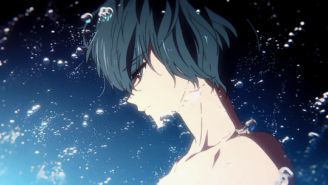

 

 
  
 

 

 

  

<table>
<tr><td align="center"><b>Languages</b></td><td></td></tr>
<tr><td align="center"><b>Systemes</b></td><td></td></tr>
</table>

  
  

  

 

  

</a>

 

  
<a href="https://github.com/gachiakuuta">

 
  

<picture>
<source media="(prefers-color-scheme: dark)" srcset="https://raw.githubusercontent.com/gachiakuuta/gachiakuuta/output/github-snake-dark.svg" />
<source media="(prefers-color-scheme: light)" srcset="https://raw.githubusercontent.com/gachiakuuta/gachiakuuta/output/github-snake.svg" />

</picture>

</a>

